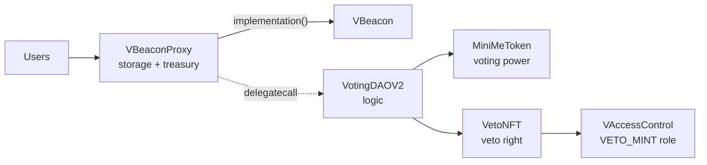

# MixBytes Farm Audit: Voting DAO

[](https://github.com/catcatcat8/mixbytes-audit/actions/workflows/test.yml)
[](LICENSE)

My security audit of an upgradeable voting DAO, written as the final assignment of the MixBytes Farm course (2022). Every Critical, High and Medium finding is reproduced by a Foundry test.

## Summary

- **Context:** final assignment of the [MixBytes](https://mixbytes.io/) Farm smart contract security course, 2022. The course provided the contracts; I did the review and wrote the report.
- **Scope:** the 13 Solidity files in [`contracts/`](contracts/), exactly as audited ([`aa8382e`](https://github.com/catcatcat8/mixbytes-audit/commit/aa8382e)).
- **Method:** manual review, cross-checked with Slither ([summary](docs/slither-summary.md)).
- **Proofs of concept:** Foundry tests in [`test/poc/`](test/poc/). Each test runs the attack against the unmodified contracts and asserts its impact. All tests pass, which means every issue is reproduced.

| ID | Finding | Severity | PoC |
|---|---|---|---|
| [C-1](#c-1-reentrancy-in-eth-withdrawal) | Reentrancy in ETH withdrawal | Critical | [`test_C1_ReentrancyWithdrawETH`](test/poc/C1_ReentrancyWithdrawETH.t.sol) |
| [C-2](#c-2-poisoned-or-non-erc-20-compatible-payment-token) | Poisoned or non-ERC-20-compatible payment token | Critical | [`test_C2_*`](test/poc/C2_PoisonedPaymentToken.t.sol) (3 tests) |
| [C-3](#c-3-arbitrary-delegatecall-in-vbeaconproxy) | Arbitrary delegatecall in `VBeaconProxy` | Critical | [`test_C3_ProxyControlledDelegatecall`](test/poc/C3_ProxyControlledDelegatecall.t.sol) |
| [H-1](#h-1-expired-proposals-can-lead-to-a-protocol-dos) | Expired proposals can lead to a protocol DoS | High | [`test_H1_ExpiredProposalsDoS`](test/poc/H1_ExpiredProposalsDoS.t.sol) |
| [H-2](#h-2-vetoed-proposals-can-lead-to-a-protocol-dos) | Vetoed proposals can lead to a protocol DoS | High | [`test_H2_VetoedProposalsDoS`](test/poc/H2_VetoedProposalsDoS.t.sol) |
| [M-1](#m-1-veto-manipulation) | Veto manipulation | Medium | [`test_M1_VetoAcceptedProposal`](test/poc/M1_VetoManipulation.t.sol) |
| [L-1](#l-1-ethtokens-can-get-stuck-on-the-vbeaconproxy-balance) … [L-6](#l-6-voting-again-for-the-same-option-only-wastes-gas) | 6 low-severity issues and recommendations | Low | — |

## How to run PoCs

Requirements: [Foundry](https://book.getfoundry.sh/getting-started/installation).

```bash
git clone --recurse-submodules https://github.com/catcatcat8/mixbytes-audit.git
cd mixbytes-audit
forge test -vv
```

Run a single finding:

```bash
forge test --match-test test_C1 -vvvv   # full call trace of the reentrancy
```

Notes:

- `MiniMeToken` is replaced by a small mock ([`MiniMeTokenMock.sol`](test/mocks/MiniMeTokenMock.sol)) that keeps per-block balance snapshots. The DAO only uses `balanceOf`, `balanceOfAt`, `totalSupply` and `decimals`, and none of the findings depend on MiniMe internals.
- The original Hardhat project used solc 0.8.4 and OpenZeppelin 4.x. The PoCs build the same sources with solc 0.8.17 and OpenZeppelin 4.9.6.

## Project structure

```
.
├── contracts/            # audited contracts, unchanged
├── test/
│   ├── poc/              # one PoC file per finding + shared deployment (Base.t.sol)
│   └── mocks/            # MiniMeToken mock
├── docs/
│   └── slither-summary.md
├── lib/                  # forge-std, OpenZeppelin (git submodules)
└── foundry.toml
```

---

# Audit report

## Project overview

The project is a DAO (decentralized autonomous organization) built with the Beacon Proxy pattern, so the DAO logic can be upgraded.

The DAO is governed by its members, who submit proposals: either empty ones or proposals to transfer ERC-20 tokens or ETH from the treasury. Every holder of the voting token (MiniMeToken) can create proposals and vote on them. Voting power equals the voter's token balance at the block where the proposal was created. Anyone can execute an accepted proposal.

The project also has an ERC-721 token (`VetoNFT`) and an access control contract that controls who can mint it. Holders of the ERC-721 token can veto proposals.

There are also libraries for safe `uint` conversion, error messages and the voting token parameters.



| Contract | Role |
|---|---|
| [`VotingDAOV2.sol`](contracts/VotingDAOV2.sol) | Proposals, voting, veto, execution and treasury payouts |
| [`Proposal.sol`](contracts/Proposal.sol) | `Proposal` and `Payment` structs; `ProposalLibrary` with state checks and the 3-day TTL |
| [`ProposalQueue.sol`](contracts/ProposalQueue.sol) | Fixed-size queue of up to 10 proposals |
| [`VBeacon.sol`](contracts/VBeacon.sol), [`VBeaconProxy.sol`](contracts/VBeaconProxy.sol) | Beacon and proxy for the DAO |
| [`VetoNFT.sol`](contracts/VetoNFT.sol) | ERC-721 that grants the veto right |
| [`VAccessControl.sol`](contracts/VAccessControl.sol), [`AccessControlled.sol`](contracts/AccessControlled.sol), [`AccessControlledRoles.sol`](contracts/AccessControlledRoles.sol) | Roles (`VETO_MINT`) |
| [`Constants.sol`](contracts/Constants.sol), [`Errors.sol`](contracts/Errors.sol), [`Uint256Helpers.sol`](contracts/Uint256Helpers.sol), [`IMiniMeToken.sol`](contracts/IMiniMeToken.sol) | Constants, error strings, safe casting, token interface |

## Severity classification

| Severity | Description |
|---|---|
| Critical | Bugs that lead to theft of assets, locked funds, or any other loss of funds. |
| High | Bugs that can cause a contract failure. Recovery is possible only by manually changing the contract state or replacing the contract. |
| Medium | Bugs that can break the intended contract logic or expose it to DoS attacks, but do not cause a direct loss of funds. |
| Low | Other non-essential issues and recommendations. |

## Summary of findings

| Severity | Number of findings |
|---|---|
| Critical | 3 |
| High | 2 |
| Medium | 1 |
| Low | 6 |

## Findings

### Critical

#### C-1. Reentrancy in ETH withdrawal

**Description**

[`VotingDAOV2.sol#L170-L174`](contracts/VotingDAOV2.sol#L170-L174), [`#L243`](contracts/VotingDAOV2.sol#L243)

```solidity
if (proposal.payment.amount > 0 && proposal.isAccepted()) {
    _withdraw(proposal.payment);
}

proposal.isExecuted = true;
```

```solidity
destination.call{value: amount}("");
```

`execute` sends ETH before it sets `proposal.isExecuted`. An attacker can create a proposal to withdraw ETH to an address that has no code yet, so it looks like an ordinary account to the voters. After the proposal is accepted, the attacker deploys a contract at exactly that address with CREATE/CREATE2. The contract's payable fallback calls `execute` again for the same proposal, and this repeats until the treasury is empty.

**Impact**

A proposal for a small amount drains all ETH from the treasury.

**Recommendation**

Set `proposal.isExecuted = true` before the `if` statement (checks-effects-interactions). If an arbitrary call is not needed, use `transfer`; otherwise check the return value of `call` and add a reentrancy guard.

**PoC**

[`test_C1_ReentrancyWithdrawETH`](test/poc/C1_ReentrancyWithdrawETH.t.sol): a 1 ETH proposal to a CREATE2 address takes the whole 10 ETH treasury.

---

#### C-2. Poisoned or non-ERC-20-compatible payment token

**Description**

[`VotingDAOV2.sol#L170-L174`](contracts/VotingDAOV2.sol#L170-L174), [`#L259`](contracts/VotingDAOV2.sol#L259)

```solidity
if (proposal.payment.amount > 0 && proposal.isAccepted()) {
    _withdraw(proposal.payment);
}

proposal.isExecuted = true;
```

```solidity
token.transfer(destination, amount);
```

A proposal to withdraw ERC-20 tokens can use any address as the token. If such a proposal is accepted, the behavior of the token's `transfer` is unpredictable. For example:

- `transfer` always reverts. The proposal can then never be executed or removed from the queue.
- `transfer` calls `execute` again (reentrancy), which can drain the treasury balance of the token.
- `transfer` moves nothing and returns `false`. The return value is ignored, so the proposal is marked as executed and users are misled.

> **Note (2026).** A token chosen by the attacker can only re-enter `execute` for its own payout, so the realistic theft path is a legitimate treasury token with transfer hooks (ERC-777 style), whose hook is triggered on the recipient. This is the case the PoC reproduces.

**Impact**

Loss of the treasury balance of tokens with transfer hooks; a queue slot locked forever; proposals marked as executed without payment.

**Recommendation**

Allow only whitelisted ERC-20 tokens in proposals. As in C-1, set `proposal.isExecuted` before the `if` statement to prevent reentrancy. Use `SafeERC20.safeTransfer` to handle tokens that return `false` or nothing.

**PoC**

[`C2_PoisonedPaymentToken.t.sol`](test/poc/C2_PoisonedPaymentToken.t.sol):

- `test_C2_CallbackTokenReentrancyDrainsTreasury`: a 100-token proposal takes all 1,000 tokens.
- `test_C2_RevertingTokenLocksQueueSlot`: an accepted proposal can never be executed, and it keeps its slot even after it expires.
- `test_C2_FalseReturningTokenMarksProposalExecuted`: nothing is paid, but the proposal is marked as executed.

---

#### C-3. Arbitrary delegatecall in VBeaconProxy

**Description**

[`VBeaconProxy.sol#L18-L20`](contracts/VBeaconProxy.sol#L18-L20)

```solidity
function __fallback() external virtual {
    msg.sender.delegatecall("TODO: implement an emergency method to temporarily pause the contract in the future...");
}
```

`__fallback()` is public, has no access control, and delegatecalls `msg.sender`. Because it is declared in the proxy itself, the call is not forwarded to the implementation. Any contract can call it, and its own code then runs in the context of the proxy: with the proxy's storage and the proxy's ETH balance. The calldata does not match any function, so the attacker's `fallback` runs.

**Impact**

Any account takes full control of the DAO in one transaction: it can transfer out all ETH and tokens, replace the beacon address in the EIP-1967 slot with its own beacon, or overwrite any other storage. No voting tokens, NFTs or roles are needed.

**Recommendation**

Remove `__fallback()`. If an emergency pause is needed, implement it in `VotingDAOV2`, behind a role check, and never delegatecall an address supplied by the caller.

**PoC**

[`test_C3_ProxyControlledDelegatecall`](test/poc/C3_ProxyControlledDelegatecall.t.sol): an account with no tokens or roles drains the 10 ETH treasury and points the proxy to its own implementation.

---

### High

#### H-1. Expired proposals can lead to a protocol DoS

**Description**

[`ProposalQueue.sol#L51`](contracts/ProposalQueue.sol#L51), [`Proposal.sol#L54-L56`](contracts/Proposal.sol#L54-L56) (`ProposalLibrary`)

```solidity
function isActive(Proposal storage proposal) internal view returns (bool) {
    return proposal.createdBlockNumber > 0 && !isRejected(proposal) && !proposal.isExecuted;
}
```

A new proposal can only replace one that was rejected or executed. Expired proposals cannot be voted on or executed. So a proposal that expires before it is rejected or executed stays in the queue forever. With 10 such proposals, the DAO stops working: `vote`, `veto` and `execute` revert because the proposals have expired, and no new proposal can be created.

**Impact**

Permanent DoS. Any token holder, even with a tiny balance, can cause it on purpose by creating 10 proposals that nobody votes on.

**Recommendation**

Add `!isExpired(proposal)` to the `return` statement of `ProposalLibrary.isActive`. Expired proposals will then be replaced when a new proposal is created.

**PoC**

[`test_H1_ExpiredProposalsDoS`](test/poc/H1_ExpiredProposalsDoS.t.sol): a holder with 1% of the supply fills the queue; after the TTL even the 60% holder cannot create a proposal.

---

#### H-2. Vetoed proposals can lead to a protocol DoS

**Description**

[`VotingDAOV2.sol#L104`](contracts/VotingDAOV2.sol#L104), [`ProposalQueue.sol#L51`](contracts/ProposalQueue.sol#L51), [`Proposal.sol#L54-L56`](contracts/Proposal.sol#L54-L56) (`ProposalLibrary`)

Vetoed proposals cannot be voted on or executed. However, a vetoed proposal can be replaced by a new one only if it had been rejected before the veto. In all other cases `ProposalLibrary.isActive` treats the vetoed proposal as active. With 10 such proposals in the queue, the DAO stops working: `vote`, `veto` and `execute` revert because the proposals are vetoed, and no new proposal can be created.

**Impact**

Permanent DoS. Together with M-1, a single VetoNFT holder can cause it on purpose.

**Recommendation**

Add `!proposal.vetoed` to the `return` statement of `ProposalLibrary.isActive`. Vetoed proposals will then be replaced when a new proposal is created.

**PoC**

[`test_H2_VetoedProposalsDoS`](test/poc/H2_VetoedProposalsDoS.t.sol): one VetoNFT holder vetoes 10 proposals, and the queue is full before any of them expires.

---

### Medium

#### M-1. Veto manipulation

**Description**

[`VotingDAOV2.sol#L104-L115`](contracts/VotingDAOV2.sol#L104-L115)

If the private key of any `VetoNFT` holder leaks, or at least one NFT ends up in the wrong hands, the new holder can veto any proposal at any time, as long as it has not expired or been executed. A proposal that has already been accepted, but not yet executed, can also be vetoed by any NFT holder.

**Impact**

One NFT holder, with no voting power, overrides the decision of the token holders.

**Recommendation**

Consider a multisig or a vote for the veto. If that does not fit, consider taking the NFT from the holder when they veto, so each NFT can be used only once. Another option is a dedicated veto role in the access control contract.

Consider forbidding the veto once `proposal.isQuorumReached()` returns `true`.

**PoC**

[`test_M1_VetoAcceptedProposal`](test/poc/M1_VetoManipulation.t.sol): a proposal accepted by 60% of the supply is vetoed by an account with no voting tokens and can no longer be executed.

---

### Low

#### L-1. ETH/tokens can get stuck on the VBeaconProxy balance

**Description**

`VotingDAOV2` has a `receive() external payable` function ([`VotingDAOV2.sol#L54`](contracts/VotingDAOV2.sol#L54)), but no way for a privileged account to return ETH or tokens. The only way out is a proposal, which is slow in an emergency.

**Recommendation**

Add a function that lets a privileged account withdraw the remaining ETH/tokens from the `VBeaconProxy` balance.

---

#### L-2. Missing events

**Description**

`veto` and `vote` in `VotingDAOV2.sol` do not emit events.

**Recommendation**

Emit events in these functions.

---

#### L-3. Unnecessary code

**Description**

- `uint32 updatedBlockNumber` in [`Proposal.sol#L20`](contracts/Proposal.sol#L20) is only updated when `vote` is called and is never read.
- `countYeas` in [`ProposalQueue.sol#L18`](contracts/ProposalQueue.sol#L18) is never used.
- `require(proposal.isQuorumReached())` in [`VotingDAOV2.sol#L167`](contracts/VotingDAOV2.sol#L167) is redundant: it follows from the next `require(proposal.isAccepted())`.
- The condition `proposal.isAccepted()` in [`VotingDAOV2.sol#L170`](contracts/VotingDAOV2.sol#L170) is always `true`: it follows from the same `require(proposal.isAccepted())`.
- `require(destination != address(0))` and `require(address(destination) != address(0))` in [`VotingDAOV2.sol#L235`](contracts/VotingDAOV2.sol#L235) and [`#L252`](contracts/VotingDAOV2.sol#L252) are redundant: `_createProposal` already checks `payment.destination != address(0)`.

**Recommendation**

Remove the unnecessary code.

---

#### L-4. Gas optimization in loop increments

**Description**

[`ProposalQueue.sol#L30`](contracts/ProposalQueue.sol#L30), [`#L39`](contracts/ProposalQueue.sol#L39)

For unsigned integers, `++i` costs less gas than `i++` or `i += 1`. With `i++` the compiler keeps a temporary copy of the old value; with `++i` the value is incremented and returned directly.

**Recommendation**

Replace post-increments (`i++`) with pre-increments (`++i`).

---

#### L-5. Function names do not match their behavior

**Description**

[`VotingDAOV2.sol#L72`](contracts/VotingDAOV2.sol#L72), [`#L88`](contracts/VotingDAOV2.sol#L88)

The names `withdrawETH` and `withdrawToken` suggest that they create a proposal to withdraw ETH or tokens. However, if `amount` is `0`, they work exactly like `createProposal` and create an empty proposal. This is confusing, and it gives three ways to create an empty proposal.

**Recommendation**

Add `require(amount > 0)` to `withdrawETH` and `withdrawToken`.

---

#### L-6. Voting again for the same option only wastes gas

**Description**

[`VotingDAOV2.sol#L124`](contracts/VotingDAOV2.sol#L124)

If a user votes again for the same option on the same proposal, the transaction does not revert and only spends gas. If it reverted, the user would most likely see the failure before sending it (a wallet warning, a failed local simulation, etc.) and would not pay for it.

**Recommendation**

Revert when a user votes for the option they have already chosen on this proposal.

---

## License

MIT — see [LICENSE](LICENSE). Author: Evgeniy Lebedev.
